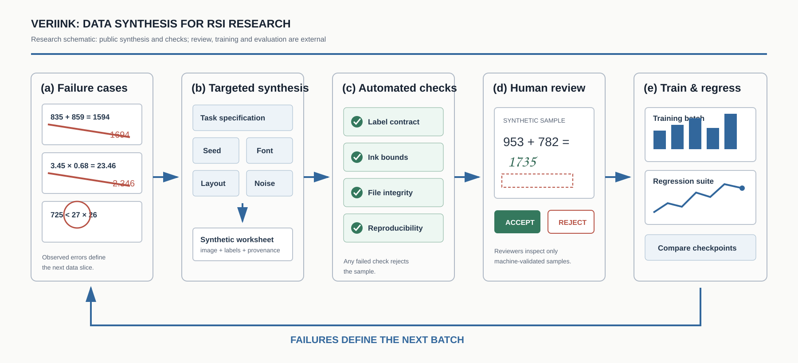

<p align="right"><strong>English</strong> · <a href="README_ZH.md">中文</a></p>

<p align="center"></p>

<p align="center">
  
  
  
</p>

**VeriInk is the verifiable synthesis layer for feedback-driven model improvement and RSI research.** Reviewed model failures guide controlled handwriting tasks. The public renderer records the seed, visible answer, target transcription, ink bounds, and file hash, making each synthetic example reproducible and inspectable.

The public edition focuses on the part that is easy to audit: deterministic rendering, intentional mistakes, crossed-out revisions, and an explicit manifest. It is designed for OCR, multimodal grading, post-training, and regression evaluation.

## Role in the RSI workflow

Here, RSI means recursive self-improvement: evidence from one iteration informs the next. VeriInk supplies controlled synthetic practice; [AlignLedger](https://github.com/znxzsy/AlignLedger) supplies human review and auditable feedback. Training and independent evaluation connect these data tools to a research loop.

| Stage | Public support | Evidence boundary |
| --- | --- | --- |
| Diagnose a reviewed failure | Manually authored task specifications | No autonomous diagnosis agent is included |
| Generate related practice | Seeded rendering, wrong answers and revisions | A fixed public task repertoire |
| Check the artifact | Label-intent checks, bounds and SHA256 | Checks do not replace visual semantic review |
| Review and freeze | Documented handoff to AlignLedger | Integration requires a domain adapter |
| Train, compare and feed back | Research workflow documented below | Training and promotion are outside this demo |

[RSI workflow and limitations](docs/RSI_WORKFLOW.md) · [中文流程](docs/RSI_WORKFLOW_ZH.md) · [Illustrative round record](examples/rsi_round.example.json)

<p align="center"></p>

The broader research includes executed training/evaluation iterations and a three-seed synthetic sampling pilot. The pilot did not establish an adaptive-sampling advantage. Independently verified capability expansion and real-world transfer remain open. Running this public demo does not reproduce those experiments.

## Method

<p align="center"></p>

The diagram shows the intended research workflow. A maintainer translates reviewed errors into task specifications; the public demo renders scenes and checks rendering intent, bounds and file integrity. Human review, training, regression and promotion are separate steps. Reproduction requires the same code, fonts, dependencies, specification and seed.

## Synthetic hard cases

<p align="center"></p>

These examples cover crossed-out revisions, decimal arithmetic, larger-number operations, and mixed-operation comparison. All six images came from the simulator. No real student image is included. Their public hashes are listed in [`examples/hardcases/manifest.json`](examples/hardcases/manifest.json).

## Reproducible audit set

<p align="center"></p>

The demo generates **16 pages and 80 answer regions** in one run. It includes arithmetic, decimals, fill-in-the-blank questions, comparisons, unit conversion, intentional mistakes, and crossed-out revisions. [`manifest.json`](examples/gallery/manifest.json) links every image to its seed, labels, bounds, and SHA256.

Wrong answers stay wrong. This is deliberate: a transcription model should copy the visible response instead of correcting it. Out-of-bounds ink, a broken label contract, or a modified file fails validation.

## Quick start

```bash
git clone https://github.com/znxzsy/VeriInk.git
cd VeriInk
python -m venv .venv
source .venv/bin/activate
pip install -e ".[dev]"
python scripts/generate_demo.py
pytest -q
```

The command rebuilds the examples, hero image, hard-case plate, audit wall, and manifests. It recomputes every hash before it exits.

## Repository layout

```text
VeriInk/
├── src/veriink/          # deterministic renderer and validation
├── scripts/              # one-command public demo build
├── examples/gallery/     # reproducible audit set
├── examples/hardcases/   # synthetic hard cases and hashes
├── assets/fonts/         # open fonts and licenses
├── tests/                # determinism and input checks
└── docs/                 # architecture and data boundary
```

## Public release boundary

The repository contains synthetic demo data only. It excludes real student data, production distributions, internal endpoints, object-storage paths, private configuration, deployment scripts, training sets, and model weights. See [SECURITY.md](SECURITY.md).

## Collaboration

The full system can be adapted to domain-specific tasks, scaled for data generation and quality gates, and connected to pre-training, post-training, or regression evaluation. For collaboration or private deployment, contact WeChat **`znxzsy`**.

## Data and license

All gallery and hard-case images are synthetic. Bundled fonts remain under their respective SIL Open Font License files. No license is granted for the remaining repository content unless stated otherwise.
