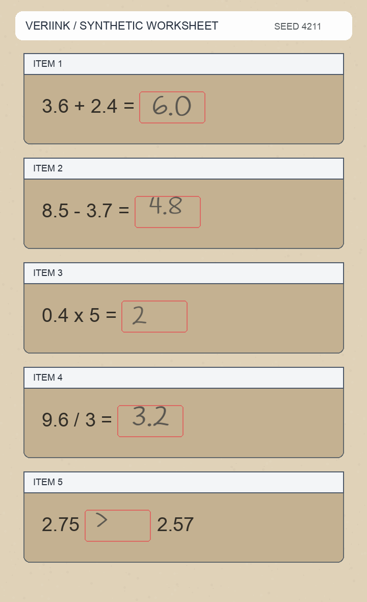
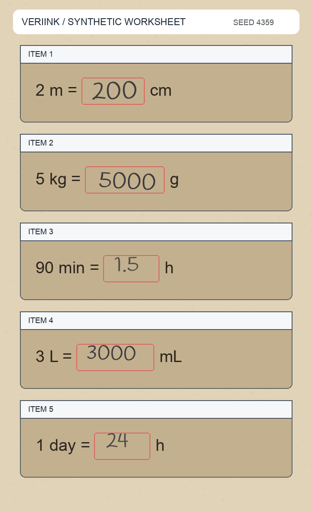
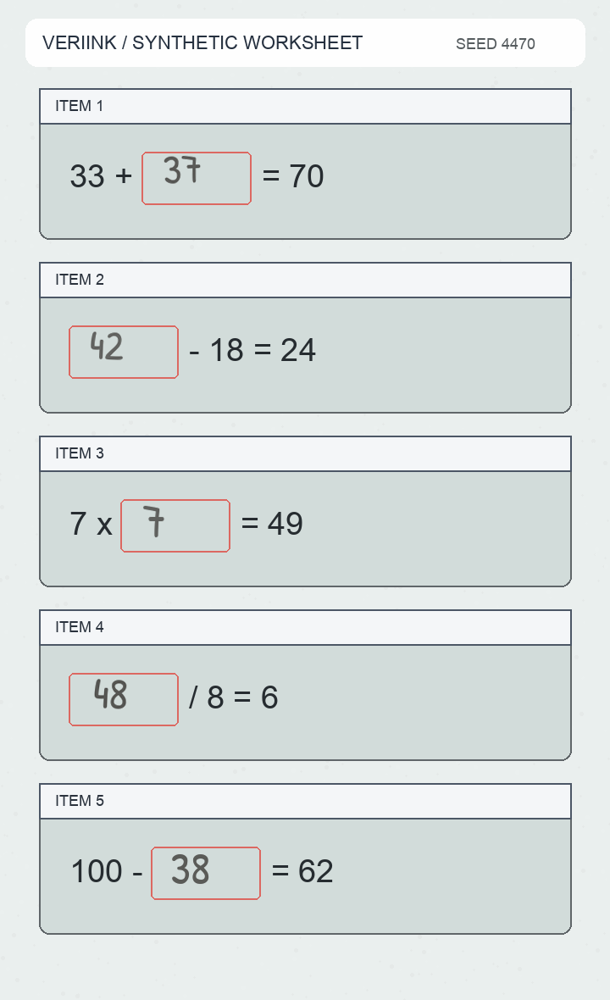
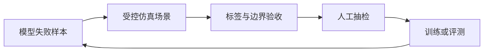

<p align="center">
  
</p>

<p align="center">
  <strong>Generate. Verify. Learn from every rejected sample.</strong><br/>
  Verifiable synthetic handwriting data for multimodal training and evaluation.
</p>

<p align="center">
  
  
  
  
</p>

写得像不像，只是第一关。真正能拿去训练的数据，还要知道它为什么被生成、应该读成什么、有没有被裁切，以及能不能用同一个 seed 再现。

**VeriInk** 是一个可验证的手写仿真 Agent。它面向 OCR、视觉语言模型和多模态批改任务，生成带标签、随机种子、边界检查和文件哈希的合成场景。正确作答、故意写错、填空、比较、单位换算和小数题可以放在同一批数据里，既能补训练分布，也能专门追着模型的薄弱点造难例。

> 我们持续为后训练与基座模型生产可验证的数据，并把失败样本送回下一轮生成与验收，形成效果自闭环。

## 一批仿真场景长什么样

下面的审查墙由公开版脚本一次性生成。图像、答案、标签、seed 和 SHA256 一一对应；不含真实学生图片，也不是从业务数据里截出来的拼贴。

<p align="center">
  
</p>

<p align="center">
  
  
  
</p>

完整公开样例包含 **12 张页面、60 个作答区域**，覆盖两种手写字体、四种纸张风格、多种题型，以及少量故意写错但仍被忠实保留的负样本。每条记录都能在 [`manifest.json`](examples/gallery/manifest.json) 中追到生成参数与验收结果。

## 它解决的不是一张图，而是一条数据链路



- **可复现**：同一份规格、字体与 seed 生成相同像素。
- **可追踪**：每张图同时记录可见答案、目标转写、标签、坐标和哈希。
- **可做难例**：允许把故意写错的答案原样渲染，不会为了数学正确擅自纠正。
- **可自动拒绝**：公开版已包含画布边界、标签契约和产物完整性检查。
- **可接训练**：manifest 是稳定的数据接口，便于接入 SFT、偏好优化和回归评测。

## 30 秒跑起来

```bash
git clone https://github.com/znxzsy/VeriInk.git
cd VeriInk
python -m venv .venv
source .venv/bin/activate
pip install -e ".[dev]"
python scripts/generate_demo.py
pytest -q
```

重新生成后，可以在 `examples/gallery/` 看到 12 张页面、审查墙和对应 manifest。脚本会在生成结束前重新计算哈希并执行验收；有一条不通过就会直接失败。

## 公开版里有什么

```text
VeriInk/
├── src/veriink/          # 精简、可读的确定性渲染器与验收器
├── scripts/              # 一键重建公开样例和审查墙
├── examples/gallery/     # 12 张纯合成场景与可审计 manifest
├── assets/fonts/         # OFL 授权字体与许可证
├── tests/                # 确定性与输入约束测试
└── docs/                 # 公开版架构与数据边界
```

这个仓库是安全裁剪后的展示版，不包含真实学生数据、生产采样分布、内部服务地址、对象存储路径、上传部署脚本、私有质量阈值、训练集或模型权重。公开页面里的所有内容都可以从仓库代码重新生成。

## 想把它接到真实训练流程里

我们在做的是一套更完整的可验证数据生产能力：针对模型失败模式生成定向样本，自动筛掉语义不一致和视觉不可信的数据，再把通过验收的样本送进训练与回归。

如果你需要以下能力，可以联系微信 **`znxzsy`**：

- 面向具体业务题型的仿真适配
- 大规模并发生成与质量门禁
- 私有化部署和数据隔离
- 后训练、基座模型与评测链路接入
- 定向 badcase 增强和效果验证

## Data & license boundary

All gallery images are synthetic. The bundled Handlee and Patrick Hand fonts are distributed under the SIL Open Font License; their license files are kept beside the font files. No license is granted for the repository's remaining content unless stated otherwise. See [SECURITY.md](SECURITY.md) for the public data boundary.

