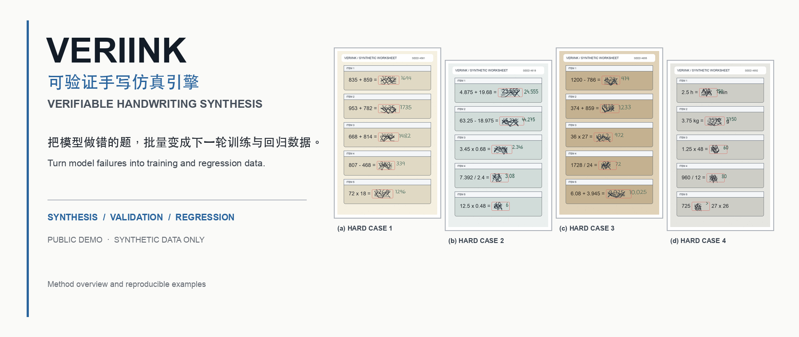
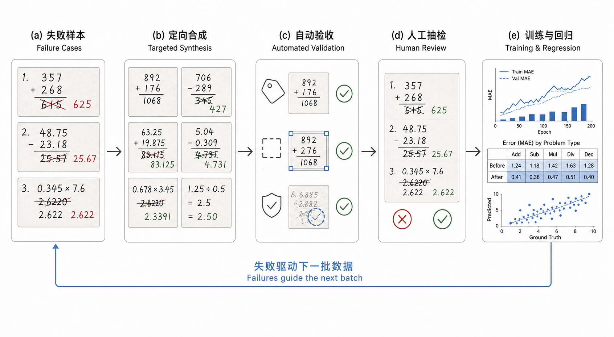
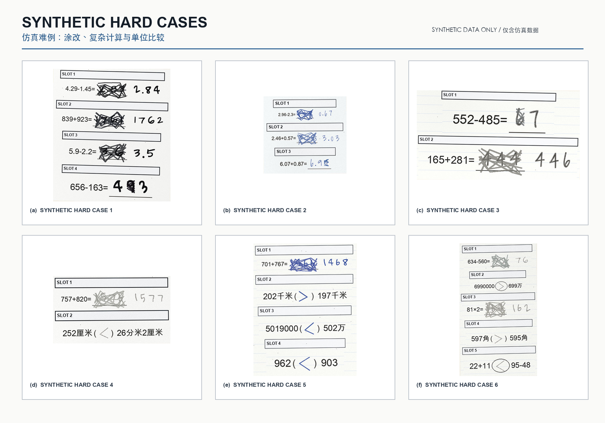
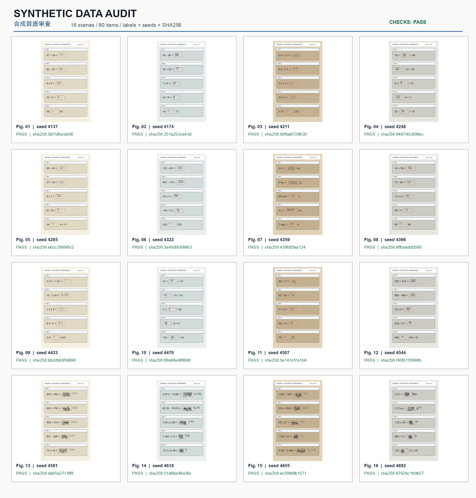

<p align="center">
  
</p>

<p align="center">
  <strong>把模型做错的题，变成下一轮训练数据。</strong><br/>
  <strong>Turn model failures into the next training batch.</strong>
</p>

<p align="center">
  
  
  
</p>

**摘要 / Abstract.** 基座模型和后训练都需要持续补充新数据，尤其是模型刚刚做错的那一类。VeriInk 把失败样本转成同类型手写场景，完成标签、边界与文件完整性检查后，直接用于训练和回归。模型哪里出错，下一批数据就补哪里。

Foundation models and post-training runs need fresh data, especially around recent failures. VeriInk turns failed cases into matching handwriting scenes, validates their labels, boundaries, and files, and sends accepted samples into training and regression. New failures decide what the next batch contains.

## 方法 / Method

<p align="center">
  
</p>

<p align="center"><sub>流程示意，不代表公开实测指标。 / Method illustration; not a reported benchmark.</sub></p>

一条失败样本先被拆成可控的题目、答案、书写方式与版面条件，再生成对应图像。自动验收负责检查像素边界、标签契约和文件哈希；人工只抽查通过机器门禁的数据。训练或回归发现的新问题会成为下一轮合成条件。

A failed sample is converted into controlled content, answer, writing, and layout conditions. Automated validation checks pixel bounds, label contracts, and file hashes before human review. Failures found during training or regression define the next synthesis batch.

## 仿真难例 / Synthetic Hard Cases

<p align="center">
  
</p>

这里展示的是涂改重写、小数计算、较大数运算、单位换算和比较题。六张图全部来自仿真引擎，并经过来源筛选；没有使用真实学生图片。公开清单与哈希见 [`examples/hardcases/manifest.json`](examples/hardcases/manifest.json)。

These examples cover crossed-out revisions, decimal arithmetic, larger-number operations, unit conversion, and comparison. All six images were produced by the simulator and source-checked. No real student image is included. Their public manifest and hashes are available in [`examples/hardcases/manifest.json`](examples/hardcases/manifest.json).

## 可复现审查集 / Reproducible Audit Set

<p align="center">
  
</p>

公开脚本一次生成 **16 张页面、80 个作答区域**，覆盖基础计算、小数、填空、比较、单位换算、故意写错和涂改重写。每张图都带 seed、标签、边界与 SHA256，结果记录在 [`manifest.json`](examples/gallery/manifest.json)。

The public script generates **16 pages and 80 answer regions** in one run. It covers arithmetic, decimals, fill-in-the-blank questions, comparisons, unit conversion, intentional mistakes, and crossed-out revisions. Every image is paired with its seed, labels, bounds, and SHA256 in [`manifest.json`](examples/gallery/manifest.json).

同一个 seed 能重建同一份样本。manifest 记录图片中可见的内容、目标转写，以及作答是否被故意写错。错答案会原样保留，用来训练模型忠实转写，而不是擅自纠正。笔迹出框、标签不一致或文件被修改，验收会直接失败。通过检查的数据可以接入 SFT、DPO/KTO 和回归集。

The same seed rebuilds the same sample. The manifest records what is visible, how it should be transcribed, and whether the response is intentionally wrong. Wrong answers stay wrong, so the model learns to transcribe instead of correcting. Out-of-bounds ink, label mismatches, or modified files fail validation. Accepted samples can feed SFT, DPO/KTO, and regression sets.

## 快速开始 / Quick Start

```bash
git clone https://github.com/znxzsy/VeriInk.git
cd VeriInk
python -m venv .venv
source .venv/bin/activate
pip install -e ".[dev]"
python scripts/generate_demo.py
pytest -q
```

命令会重建公开样例、双语主图、审查墙和 manifest，并在结束前重新计算哈希与执行验收；任意一项不通过都会以非零状态退出。

The command rebuilds the public examples, bilingual hero, audit wall, and manifest. It recomputes hashes and runs validation before exiting; any failed check returns a non-zero status.

## 仓库结构 / Repository Layout

```text
VeriInk/
├── src/veriink/          # 确定性渲染与验收 / deterministic rendering and validation
├── scripts/              # 一键重建公开样例 / one-command public demo build
├── examples/gallery/     # 可复现审查集 / reproducible audit set
├── examples/hardcases/   # 仿真难例与哈希 / synthetic hard cases and hashes
├── assets/fonts/         # 开源字体与许可证 / open fonts and licenses
├── tests/                # 确定性和输入约束测试 / determinism and input checks
└── docs/                 # 架构与公开数据边界 / architecture and data boundary
```

## 公开版范围 / Public Release Boundary

本仓库是安全裁剪后的展示版。它不包含真实学生数据、生产采样分布、内部服务地址、对象存储路径、私有配置、上传部署脚本、训练集或模型权重。公开页面中的训练示例全部为仿真数据。

This repository is a safety-scoped public demo. It excludes real student data, production distributions, internal endpoints, object-storage paths, private configuration, deployment scripts, training sets, and model weights. Every training example shown on the public page is synthetic.

## 合作 / Collaboration

完整版本可适配特定题型、扩展并发生成与质量门禁，并接入基座训练、后训练和回归评测。合作或私有化需求请联系微信 **`znxzsy`**。

The full system can be adapted to domain-specific tasks, scaled for generation and quality gating, and connected to pre-training, post-training, and regression evaluation. For collaboration or private deployment, contact WeChat **`znxzsy`**.

## 数据与许可 / Data and License

本仓库的 gallery 与 hard-case 图片全部为仿真数据。内置字体遵循各自的 SIL Open Font License；除非另有说明，仓库其余内容不自动授予许可。公开数据边界见 [SECURITY.md](SECURITY.md)。

All gallery and hard-case images in this repository are synthetic. Bundled fonts remain under their respective SIL Open Font License files. No license is granted for the remaining repository content unless stated otherwise. See [SECURITY.md](SECURITY.md) for the public data boundary.
